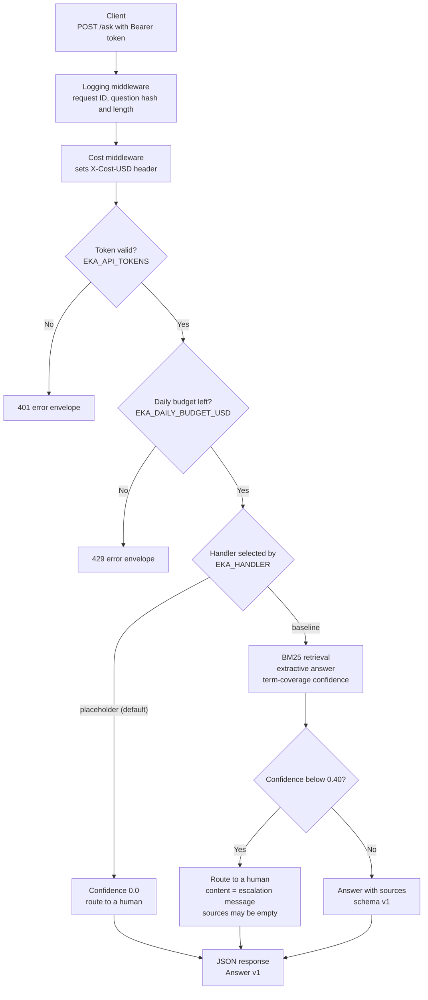

# Capstone Milestone 1: Enterprise Knowledge Assistant (EKA)
[](#capstone-milestone-1-enterprise-knowledge-assistant-eka)

This repository contains the Milestone 1 (M1) package for an end-to-end Retrieval Augmented Generation (RAG) assistant. It answers employee questions from approved internal documents, with citations, a confidence score, and escalation to a human when it cannot answer reliably.

M1 defines the scope, corpus, evaluation set, API contract, and KPIs, and builds the API skeleton and an offline lexical baseline. It does **not** yet implement dense embeddings, reranking, or LLM generation. The default answer handler is a labelled placeholder.

## 🗺️ Architecture Overview
[](#%EF%B8%8F-architecture-overview)

The target design (ADR 0001) is a grounded RAG pipeline behind a stable HTTP contract:

```
Approved documents ──► Ingest & version ──► Chunk by section ──► Index (BM25 + embeddings)
                                                                   │
Employee ──► POST /ask ──► Auth, log, cost ──► Hybrid retrieve ──► Rerank ──► Grounded generation
                                  │                                              │
                                  │                       Cite sources + score confidence
                                  ▼                                              │
                          Cost / audit log ◄─────────── Answer (schema v1) ◄──── Escalate if confidence < 0.40
```

What is implemented in M1:

| Stage | Status | Where |
|---|---|---|
| Auth, request logging, cost tracking | ✅ Built | `src/api/` |
| `POST /ask` contract, `Answer` schema v1 | ✅ Built | `src/api/main.py`, `src/pipeline/models.py` |
| Section-level chunking and BM25 retrieval | ✅ Built (offline baseline) | `scripts/run_rag_eval.py` |
| Extractive answer and term-coverage confidence | ✅ Built (offline baseline) | `scripts/run_rag_eval.py` (`FakeEKA`) |
| Dense embeddings, hybrid retrieval, reranker | ⏳ Planned (later milestones) | n/a |
| LLM grounded generation, answer-support check | ⏳ Planned (later milestones) | n/a |

The request path is: **auth → budget check → handler → cost and log middleware → response**. The handler is a seam (`AnswerHandler` protocol in `src/pipeline/handler.py`), so later milestones replace the handler without changing the API, authentication, logging, or cost tracking.

**Request flow as built in M1:**



---

## 📁 1. API Layer (`src/api/`)
[](#-1-api-layer-srcapi)

The FastAPI service that exposes the assistant over HTTP.

- **`main.py`**: The application factory `create_app()`. Exposes `GET /health`, `POST /ask`, and `GET /usage`. Every non-2xx response uses one error envelope (`code`, `message`, `request_id`, `details`). Selects the handler from `EKA_HANDLER`: `placeholder` (default) or `baseline`.
- **`auth.py`**: Bearer-token authentication. Tokens come from `EKA_API_TOKENS` as `name:token` pairs. Fails closed when no tokens are set, and compares tokens in constant time with `hmac.compare_digest`. The token name becomes the caller's principal for logging and budget accounting.
- **`cost_tracking.py`**: `CostTracker` keeps an in-memory, thread-safe daily ledger per principal and UTC date. `check_budget()` runs before paid work and returns HTTP 429 when the budget is used up. `CostTrackingMiddleware` records each answer's cost and sets the `X-Cost-USD` response header.
- **`logging_middleware.py`**: Structured request logging with a request ID on every request. Logs a question hash and length by default. Question text is logged only when `EKA_LOG_QUESTIONS=1` (local development only).

## 🧱 2. Contracts and Handlers (`src/pipeline/`)
[](#-2-contracts-and-handlers-srcpipeline)

- **`models.py`**: The `Answer` model, which is the v1 response schema (`content`, `cost_usd`, `retries`, `confidence`, `sources`, `schema_version`). Also defines `AskRequest`, `ErrorResponse`, `HealthResponse`, and `UsageResponse`. `ESCALATION_THRESHOLD = 0.40` and the standard escalation message live here.
- **`handler.py`**: The `AnswerHandler` protocol and `PlaceholderHandler`. The placeholder returns confidence `0.0`, so clients route the employee to a human.
- **`baseline_handler.py`**: `BaselineHandler`, enabled with `EKA_HANDLER=baseline`. Serves the offline lexical baseline through `/ask`. It makes no model calls, so its cost is reported as `0`.

## 🔎 3. Offline Baseline and Evaluation (`scripts/`)
[](#-3-offline-baseline-and-evaluation-scripts)

`run_rag_eval.py` holds the retrieval logic and the evaluation harness:

- **Chunking** (`load_corpus`): Splits each corpus document on `## ` headings. Each chunk keeps its `doc_id` and section number, giving citations in the form `doc_id#section`.
- **Tokenization** (`tokenize`): Lowercases, removes stopwords, and applies crude plural stripping.
- **Retrieval** (`FakeEKA`): BM25 scoring with `k1=1.5` and `b=0.75`, returning the top-k chunks.
- **Confidence**: IDF-weighted term coverage of the top-1 chunk. Below `0.40`, the system escalates.
- **Answer**: The three best-matching sentences from the top chunks, with their sources.
- **Scoring**: Checks answerable questions for correct facts and citations, and escalation questions for correct escalation. `--compare` reports changes against a saved run.

- **`run_rag_eval.py`**: Runs the golden set. `--fake` runs the offline baseline with no API calls and no cost. Without `--fake`, it calls a live `/ask` endpoint (`--endpoint`).
- **`validate_m1.py`**: Checks the M1 success criteria: corpus, golden set, required files, ADR sections, schema, and the one-pager. `--strict` fails until every golden question is human-verified.

## 🧪 4. Tests (`tests/`)
[](#-4-tests-tests)

`pytest` suites for the milestone: 36 test functions, which run as 51 test cases including parametrized inputs.

- **`test_api.py`**: Authentication (including fail-closed behaviour), the error envelope, request-ID and logging rules (question text and tokens never logged by default), cost headers, and the daily budget guard.
- **`test_models.py`**: Freezes the v1 `Answer` field set so accidental contract changes fail, and checks field types, ranges, and the escalation convention.
- **`test_eval.py`**: Scoring rules, corpus chunking, determinism of the offline baseline, and the evaluation CLI.

## 📚 5. Documentation (`docs/`)
[](#-5-documentation-docs)

- **`adr/0001-capstone-framing.md`**: Context, problem, scope, KPIs (baseline, target, justification), technology approach, alternatives, trade-offs, and known gaps.
- **`adr/0002-api-contract.md`**: The `/ask` specification, schema v1, versioning rules, and evolution plan.
- **`stakeholder-map.md`**: Named personas and the wider stakeholder map.

## 💾 6. Data and Auxiliary Files
[](#-6-data-and-auxiliary-files)

- **`data/corpus/`**: 16 synthetic, approved-for-project-use policy documents in three clusters: `hr/` (HR-001 to HR-005), `it/` (IT-001 to IT-006), and `ops/` (OPS-001 to OPS-005). `manifest.csv` lists them. Each document has numbered sections for citations.
- **`data/golden_set_full.jsonl`**: 20 golden questions (8 easy, 8 medium, 4 hard). Hard questions test escalation.
- **`eval_results/baseline.json`**: The saved baseline run, the reference for future comparisons. `my-change.json` is a second saved run.
- **`DR1_OnePager.pdf`**: The Design Review (DR#1) one-pager.
- **[`m1-capstone-handoff.md`](m1-capstone-handoff.md)**: Milestone handoff: locked decisions, KPIs, baseline results, known gaps, and open items.
- **`requirements.txt`** and **`pytest.ini`**: Dependencies and test configuration.

---

## 📊 Baseline Result
[](#-baseline-result)

Offline lexical baseline (BM25 and extractive answers, untuned):

| Slice | Pass rate |
|---|---|
| Easy (8) | 50% |
| Medium (8) | 0% |
| Hard (4) | 25% |
| **Overall (20)** | **25%** |

This is the floor that later RAG versions must beat. Known gap: the ADR target confidence combines retrieval strength, evidence agreement, and an answer-support check, but the baseline uses only top-1 term coverage. The 0.40 threshold is an untuned starting value. The handoff ([m1-capstone-handoff.md](m1-capstone-handoff.md)) lists the full KPI table (K1 to K3) and the known-gap effects, such as 3 of 4 hard questions answered instead of escalated.

---

## 🚀 Quick Start
[](#-quick-start)

Run these from the project root (`M1_Capstone_ShivaShankarGudipati`) in PowerShell.

```powershell
# Create the environment and install dependencies
py -3.14 -m venv .venv
.\.venv\Scripts\Activate.ps1
python -m pip install --upgrade pip
python -m pip install -r requirements.txt

# 1. Unit tests
python -m pytest

# 2. Offline baseline evaluation (no API calls, no cost)
python .\scripts\run_rag_eval.py --fake --label baseline
python .\scripts\run_rag_eval.py --fake --label my-change --compare baseline

# 3. Check the M1 success criteria
python .\scripts\validate_m1.py
```

### Run the API

Set at least one token. Without `EKA_API_TOKENS`, every protected call returns 401.

Generate a random token (24 random bytes, shown as 48 hex characters) and set it for this terminal:

```powershell
$b = New-Object byte[] 24
[Security.Cryptography.RandomNumberGenerator]::Create().GetBytes($b)
$token = ($b | ForEach-Object { $_.ToString("x2") }) -join ""
$env:EKA_API_TOKENS = "dev:$token"
$token    # prints it, so you can copy it into terminal 2
```

Optional settings, then start the server:

```powershell
$env:EKA_DAILY_BUDGET_USD = "25"    # default 25
$env:EKA_HANDLER = "baseline"       # or "placeholder" (default)

uvicorn src.api.main:app --reload
```

Call the endpoint from a second terminal:

```powershell
Invoke-RestMethod -Method Post -Uri http://localhost:8000/ask `
  -Headers @{ Authorization = "Bearer <token>" } `
  -ContentType "application/json" `
  -Body '{"question": "How many days of annual leave do employees receive?"}'
```

Other endpoints: `GET /health` (no auth), and `GET /usage` (auth, today's spend for the caller).

---

## ⚙️ Configuration
[](#️-configuration)

| Variable | Default | Purpose |
|---|---|---|
| `EKA_API_TOKENS` | none (fail closed) | `name:token` pairs for bearer authentication |
| `EKA_DAILY_BUDGET_USD` | `25` | Per-caller daily cost budget |
| `EKA_HANDLER` | `placeholder` | `placeholder` or `baseline` |
| `EKA_LOG_QUESTIONS` | unset | Set to `1` to log question text (development only) |

Never commit real tokens. Keep them in your local shell or an untracked `.env` file.

---

## 🛣️ Roadmap
[](#️-roadmap)

- **Next**: Ingestion, section chunking, and hybrid retrieval (BM25 plus embeddings) behind the existing `AnswerHandler` protocol.
- **Then**: Reranking, grounded LLM generation with citations, and the answer-support check that feeds confidence.
- **Ongoing**: Human-verify all golden questions, replace the estimated KPI baselines with real ticket and survey data, and grow the golden set to 100+ questions.

Open items are tracked in [m1-capstone-handoff.md](m1-capstone-handoff.md).
